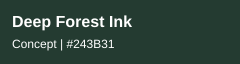
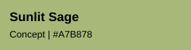
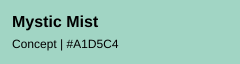
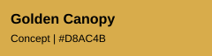
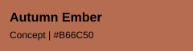
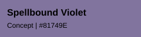
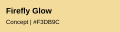

# Desert Sky

A nine-color acrylic palette for a bold, comic/manga-style desert adventure: a red-haired girl, her pet, and a flying contraption. Inspired by the vivid warm/cool contrasts of *Aetherdrift*.

 ✓ 

  ✓

  

✓ = Paints I own (Fire Coral and Bahama Blue).

**Brand balance:** 5 FolkArt · 2 Delta Ceramcoat · 2 DecoArt Americana.

**Painting notes:** Let Bahama Blue establish the open sky; use Bright Red for the focal sail or costume, Fire Coral for warm accents, Sunflower and Honey Brown for sunlit desert forms, and Dunes Beige for peach-sand highlights. Violet Pansy provides cool shadow shapes; Midnight is the near-black colored ink, while Burnt Umber handles warm recesses and weathered machinery.

Digital swatches are approximate. [Browse the paint-color inventory](paint-color-inventory.md).

---

# Forest Whispers

A nine-color acrylic concept palette for an enchanted forest illustration: a young magician helping small woodland creatures. Cool mossy greens and misty turquoise establish the woodland, while autumn gold, rust, violet, and firefly light draw attention to the characters and magic.

  

  

  

**Painting notes:** Use Deep Forest Ink for colored outlines and deep shadows; Mossy Fern and Sunlit Sage for foliage; Mystic Mist and Enchanted Teal for atmosphere and water; Golden Canopy and Autumn Ember for leaves and the magician's warm accents; Spellbound Violet for creatures and spell effects; and Firefly Glow for the brightest magical highlights.

**Paint matching:** These are proposed HEX reference colors, not yet verified matches to DecoArt Americana, FolkArt, or Delta Ceramcoat paint numbers. Digital swatches are approximate.
